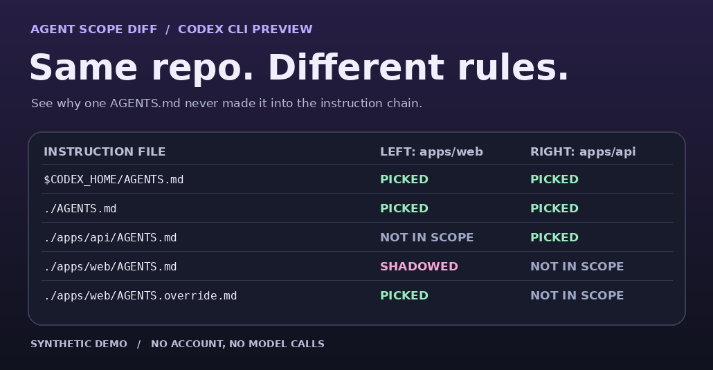

# Agent Scope Diff

**Same repo. Different rules.** See what Codex would read from two launch directories, and why one `AGENTS.md` never made it in.



In a monorepo, starting Codex in the root and starting it in `apps/web` can produce different instruction chains. An override can silently shadow a rule file, and the project byte budget can cut off a deeper instruction. This tool makes those decisions visible before you start a session.

## Try it in 20 seconds

Get this source directory and run the built-in example with Python 3.11+:

```sh
python3 agent_scope_diff.py compare examples/demo-project/apps/web examples/demo-project/apps/api --root examples/demo-project --codex-home examples/demo-home --json | python3 report.py > scope.html
```

Open `scope.html` locally. The two columns show that the web launch selects `apps/web/AGENTS.override.md` and shadows `apps/web/AGENTS.md`, while the API launch selects its own `AGENTS.md`. The root and opt-in global instructions appear on both sides. The demo files are synthetic.

## Use it on your repo

```sh
# Explain a single launch directory. Run from this source directory.
python3 agent_scope_diff.py /path/to/repo/apps/web

# Compare your repo root and a nested launch directory.
python3 agent_scope_diff.py compare /path/to/repo /path/to/repo/apps/web

# Model explicit settings rather than guessing from your machine's config.
python3 agent_scope_diff.py /path/to/repo/apps/web --root /path/to/repo --codex-home ~/.codex --fallback TEAM_GUIDE.md --budget 32768
```

Add `--json` for structured output. Pipe comparison JSON into `report.py` for a standalone diagram you can open without hosting anything; you can also pass a JSON filename. On Windows use `py -3` in place of `python3`.

| Status | Meaning |
| --- | --- |
| Picked | The first available candidate in that directory contributed bytes. |
| Shadowed | A higher-priority filename won in the same directory. |
| Empty | A candidate won but contributed no non-whitespace content. |
| Truncated | Only the remaining project byte budget fitted. |
| Budget exhausted | A candidate was found but the project budget was already spent. |
| Error | The preview could not complete this read; check the diagnostic. |

A successful scan is exit 0 even when differences are found. Exit 2 indicates invalid inputs or an incomplete preview. JSON includes `schema_version: 1`; comparison output describes differences from left to right. The report renderer only accepts schema 1 comparisons.

## Scope and privacy

- **Local, read-only analysis.** No API key, Codex process, network calls, or third-party dependencies. HTML generation only writes to stdout.
- **Codex CLI preview, not a recording.** It discovers files on the launch directory's ancestor chain and never verifies what a live session ingested or what a model followed. See OpenAI's [AGENTS.md guide](https://learn.chatgpt.com/docs/agent-configuration/agents-md) and [resolver source](https://github.com/openai/codex/blob/main/codex-rs/core/src/agents_md.rs).
- **Explicit approximations.** The default root is the nearest `.git` marker; without one, only the supplied working directory is inspected unless `--root` is given. A supplied `--root` must contain both directories in a comparison. Global instructions are opt-in, excluded from the project budget, and skipped with an error over 8 MiB. Project trust, merged settings, remote sessions, later file reads and dynamically supplied instructions aren't modeled.
- **Share the HTML carefully.** It keeps relative names, statuses, and byte counts but removes absolute machine paths, file content, warning text, and hashes. Terminal and JSON output do contain absolute paths; JSON also includes hashes of selected bytes. Even relative names can be private.

Not affiliated with OpenAI. Existing tools such as [instructree](https://github.com/kotobuki09/instructree) and [agents-md-doctor](https://github.com/ItsHege/agents-md-doctor) cover broader instruction audits. Agent Scope Diff focuses on one question: how does changing the launch directory change the instructions?

## Develop

```sh
python3 -m unittest discover -s tests -v
```

See [中文说明](README.zh-CN.md).
